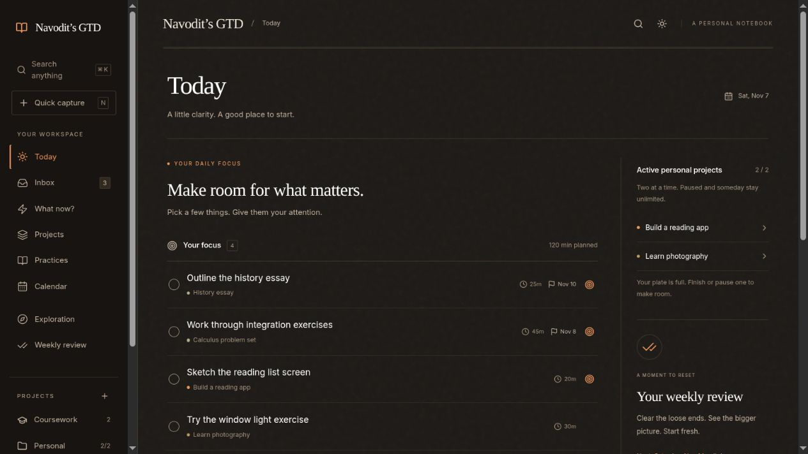
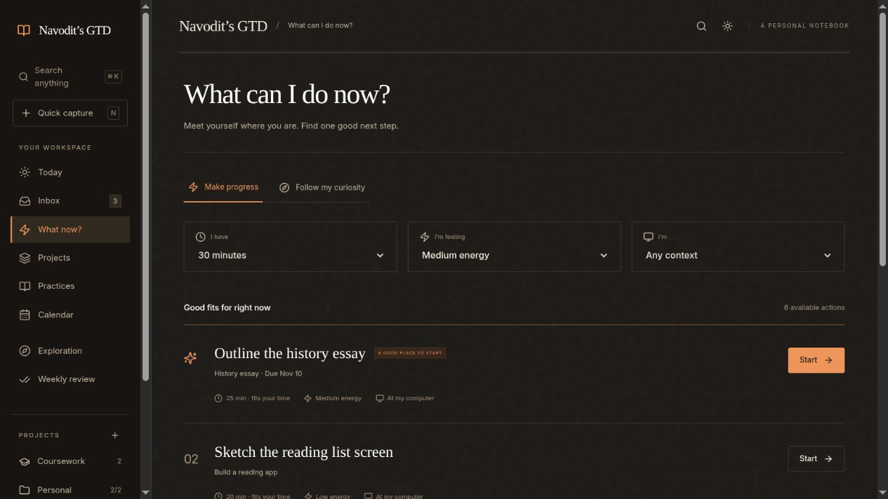
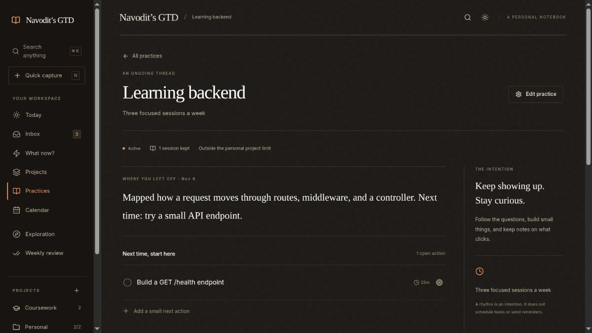
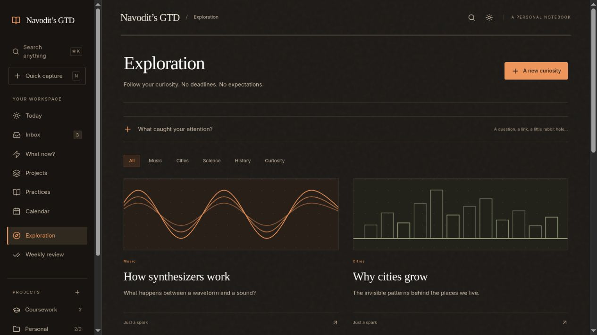
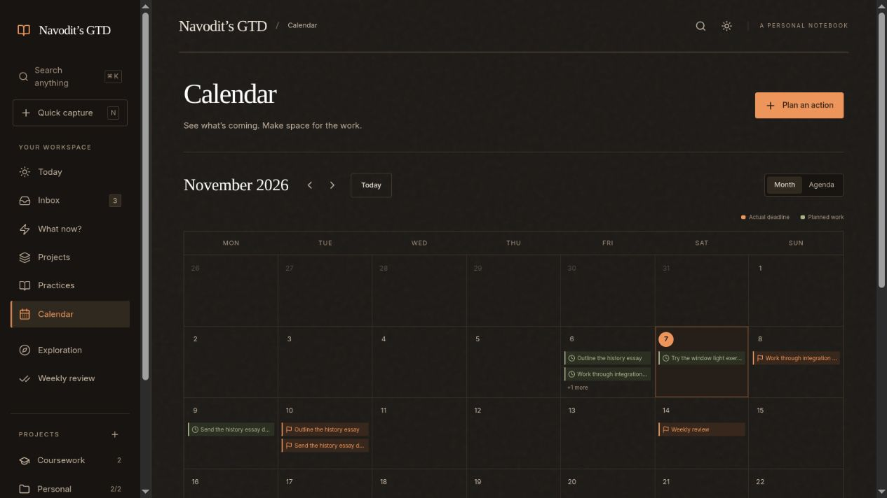
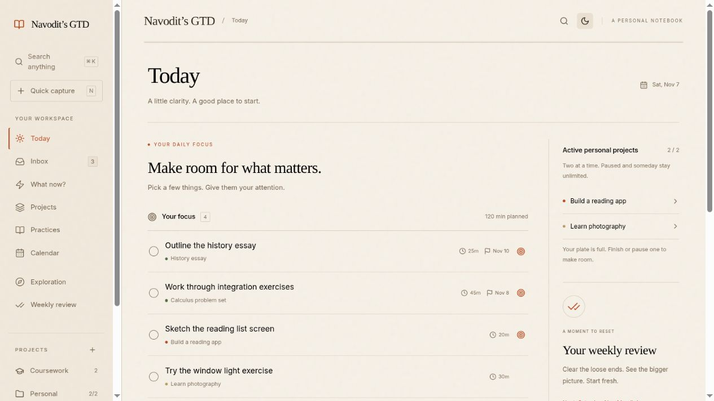

<div align="center">

# Navodit’s GTD

**Small steps. A clearer mind.**

A personal GTD notebook for coursework, projects, ongoing learning, and the occasional rabbit hole.
Built for desktop and Android, with warm paper textures, serif headings, and a dark theme made for everyday use.

[Open the app](https://navodits-gtd.vercel.app) · [Features](#features) · [Screenshots](#screenshots) · [Run locally](#run-locally)

</div>



> The hosted app is a private, owner-only workspace. Screenshots use a separate local sample workspace; they contain no private cloud data.

## The idea

Capture what’s on your mind, clarify the next action, and choose something that fits the moment. Keep projects finite, learning continuous, and curiosity free of deadlines.

- **A task is an action:** outline an essay, build an endpoint, send a draft.
- **A project has an outcome:** finish a reading app or submit a coursework assignment.
- **A practice has a direction:** learn backend development or keep working through LeetCode.
- **An exploration is a possibility:** save a question without committing to doing anything about it.

## Features

| Space | What it does |
| --- | --- |
| **Today** | Brings together daily focus, work planned for today, due or overdue actions, upcoming deadlines, and the weekly review when due. |
| **Inbox** | Quick capture, then clarify into next actions, waiting for, or someday. Keep completed actions accessible. |
| **What can I do now?** | Suggests available next actions using your time, energy, context, planned dates, and active project status. Includes an elapsed focus timer and a curiosity option. |
| **Projects** | Separates coursework and personal projects, with desired outcomes, next actions, and active, paused, someday, or complete states. |
| **Practices** | Gives long-running learning a home: notes and resources, a descriptive rhythm, dated session history, a where-you-left-off summary, and small next actions. |
| **Calendar** | Month and agenda views distinguish actual deadlines from dates when you intend to work. |
| **Exploration** | Collects questions, notes, links, and tags. Follow a rabbit hole or turn it into a personal project when you choose. |
| **Weekly review** | Six guided steps and an automatic Saturday review task to clear loose ends and reset. |

### Two active personal projects

Personal projects have **two active slots**. Pause or finish one before activating another. Paused, someday, and completed projects are unlimited; coursework and practices never consume these slots.

The limit is enforced when creating, editing, activating, converting, importing, and loading older data. Legacy workspaces with three active personal projects keep their data: additional projects move to Paused with a visible notice.

### A Saturday reset

The weekly review is an all-day task every **Saturday**, estimated at **20 minutes**. It appears in Today when due and stays visible if overdue. Completing the task or guided checklist schedules the following Saturday. Missed weeks leave one overdue review rather than a growing backlog.

Dates follow the device’s local calendar. This is a recurring task, not a timed notification.

### A notebook on every device

- **Email-link sign-in** through Supabase Auth, with owner-only database access.
- **Cloud saving** across signed-in devices, with sync after edits, on reconnect or focus, and periodically while open.
- **Offline editing** using an account-specific device cache; pending edits sync after reconnection.
- **Conflict handling:** if both device and cloud copies changed, choose which complete copy to keep. Download a device backup before replacing it; automatic merging is not implemented.
- **JSON export and import** with validation. Importing replaces the workspace and syncs that replacement.
- **Installable PWA** with icons, bundled fonts, and a cached offline app shell.
- **Warm ink dark and cream light themes**, responsive navigation, and keyboard shortcuts.

## Screenshots

Captured from the current app with sample data. Expand each view for a closer look.

<details>
<summary><strong>What now? — choose an action that fits your time and energy</strong></summary>



</details>

<details>
<summary><strong>Practices — pick up a learning thread where you left off</strong></summary>



</details>

<details>
<summary><strong>Exploration — curiosity without obligations</strong></summary>



</details>

<details>
<summary><strong>Calendar — deadlines and planned work in one place</strong></summary>



</details>

<details>
<summary><strong>Light mode — cream paper and warm orange accents</strong></summary>



</details>

## A simple daily flow

1. **Capture** loose thoughts in Inbox.
2. **Clarify** each item into an action, project, practice, or someday possibility.
3. **Choose** a few focus actions in Today, or use What now when you have a spare moment.
4. **Keep the thread** by recording what you learned in a practice session.
5. **Review on Saturday** to close loops and decide what deserves attention next.

## Keyboard shortcuts

| Shortcut | Action |
| --- | --- |
| `N` | Quick capture |
| `Ctrl / Cmd + K` | Search the workspace |

## Install on Android

Open [the app](https://navodits-gtd.vercel.app), sign in, and use your browser’s **Install app** or **Add to Home screen** option. Available wording and standalone behavior depend on the browser. You can also keep using the app in a normal browser tab.

Visit online once and allow the service worker to install before relying on the offline shell. Signing in requires connectivity; cached workspace data stays scoped to the account on that device.

## Run locally

Requires Node.js **20.19+ or 22.12+** and npm.

```sh
git clone https://github.com/Navoditdev/navodits-gtd.git
cd navodits-gtd
npm ci
npm run dev
```

**Local demo:** without Supabase environment variables, the app starts with editable sample data stored only in that browser. It does not sync with the hosted workspace.

**Cloud mode:** copy `.env.example` to `.env.local` and configure `VITE_SUPABASE_URL` and `VITE_SUPABASE_PUBLISHABLE_KEY`. The database schema, owner access, and Auth redirect URLs must also be configured; see [DEPLOYMENT.md](DEPLOYMENT.md). Use only a browser-safe publishable key, never a secret or service-role key. This installation currently restricts sign-in and workspace access to its configured owner; adapt both the client and database policies for your own installation.

```sh
npm run build    # TypeScript, Vite, and the generated offline shell
npm run preview  # Serve the production build locally
```

## Tech stack

| Layer | Technology |
| --- | --- |
| Interface | React 19, TypeScript, Vite, Lucide icons |
| Design | CSS tokens, bundled Inter, serif headings, paper textures |
| Authentication | Supabase email-link Auth |
| Database | Supabase Postgres, row-level security, versioned workspace saves |
| Offline | Account-scoped localStorage cache and a versioned service worker |
| Hosting | Vercel with GitHub deployment integration |

## Current boundaries

General recurring tasks, push notifications, timed reminders, external calendar integrations, and automatic conflict merging are not implemented. Practice rhythms describe intentions; they do not generate scheduled sessions.

Export backups regularly, especially before importing data or resolving a conflict. Moving from the older preview to the production URL requires exporting and importing a backup because browser storage belongs to an origin.
